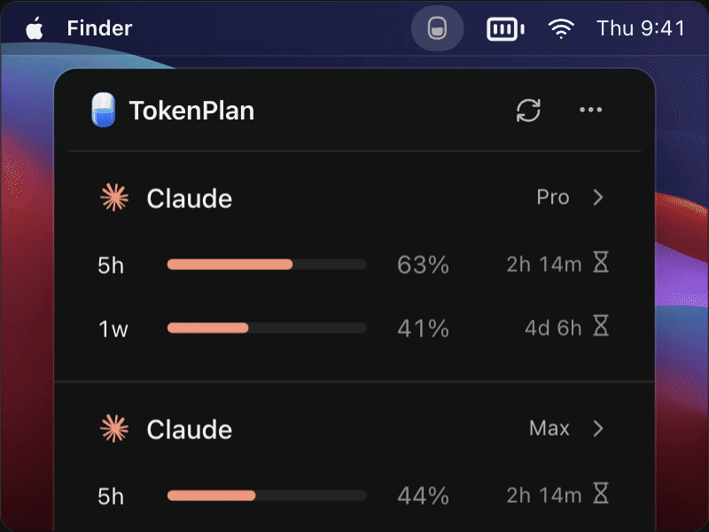
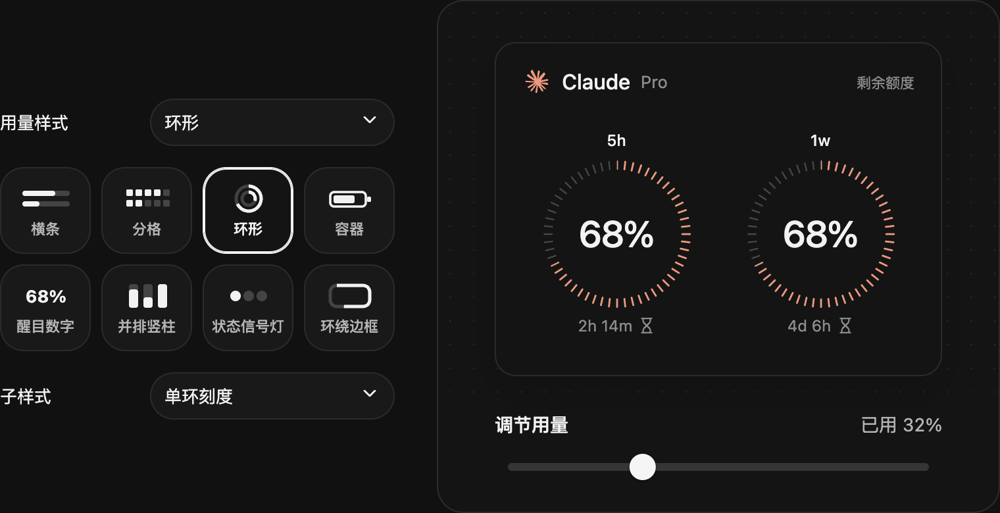
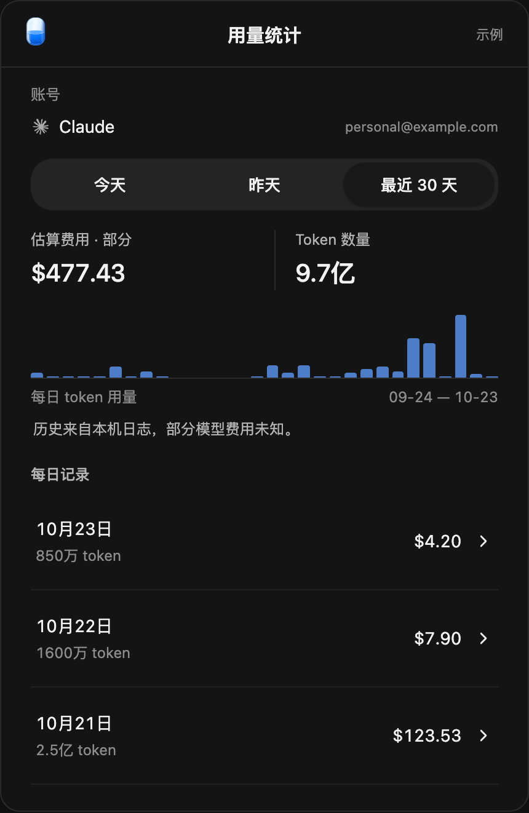

  
  <h1>TokenPlan</h1>
  
在菜单栏或系统托盘，查看 AI 订阅额度、余额与用量。

  
<a href="https://github.com/onevalar/token-plan/releases/latest">下载</a> · <a href="https://github.com/onevalar/token-plan/issues">反馈</a> · <a href="docs/README.md">文档</a>

支持 **macOS、Windows、Linux**，提供简体中文、繁體中文、English、日本語和 한국어。

[体验交互演示](https://onevalar.github.io/token-plan/) · 展示使用示例数据。

## 下载

<!-- download-links:start -->
当前正式版：**2.3.5** · [发布说明](https://github.com/onevalar/token-plan/releases/tag/v2.3.5)

| 系统 | 安装包 | 平台要求 |
| --- | --- | --- |
| **macOS** | [下载 DMG](https://github.com/onevalar/token-plan/releases/download/v2.3.5/TokenPlan_2.3.5_universal.dmg) | macOS 15 及以上；Apple Silicon / Intel 通用版 |
| **Windows** | [下载 EXE](https://github.com/onevalar/token-plan/releases/download/v2.3.5/TokenPlan_2.3.5_x64-setup.exe) | Windows x64；需要 WebView2 |
| **Linux** | [下载 AppImage](https://github.com/onevalar/token-plan/releases/download/v2.3.5/TokenPlan_2.3.5_linux2_amd64.AppImage) · [下载 DEB](https://github.com/onevalar/token-plan/releases/download/v2.3.5/TokenPlan_2.3.5_linux2_amd64.deb) | Ubuntu 22.04 / 24.04 x64 验证；需要图形桌面 |

<!-- download-links:end -->

### macOS 经典版

[下载 1.0.12](https://github.com/onevalar/token-plan/releases/download/v1.0.12/TokenPlan-1.0.12.dmg)。经典版仅保留下载，不再更新；请勿与新版同时运行。

## 功能

- 集中查看 Claude、Codex、Cursor、Antigravity 等服务的额度、余额和重置时间。
- 多账号管理、拖动排序、按订阅服务自定义用量样式与即时预览。
- 本地用量统计、token 记录和费用估算。
- macOS 菜单栏支持环形、百分比及 token 趋势；Windows/Linux 提供系统托盘入口。

### 用量样式

选择适合自己的展示方式，调整用量即可预览变化。

### 用量统计

查看每日记录与模型构成；费用为估算。

## 开始使用

安装后，从「订阅管理」添加账号，按引导连接已有登录或创建独立配置目录，再点击刷新。外观与用量样式在「通用设置」中调整。

应用内可检查更新；Linux 自动更新使用 AppImage，DEB 用户需下载安装新版安装包。详细步骤见[安装说明](docs/tauri-installation.md)。

数据保存在本机，不收集使用统计或崩溃报告。额度查询需要连接对应服务；历史费用为估算，不等于账单。[隐私说明](docs/privacy.md)

## 开发与许可

[构建说明](docs/tauri-migration.md#building-and-checking) · [开发约定](AGENTS.md) · [许可证](LICENSE)

项目代码采用 MIT 许可，Arc Pro 等第三方组件按各自许可使用，详见[组件声明](platforms/tauri/src/components/arc/NOTICE.md)。
